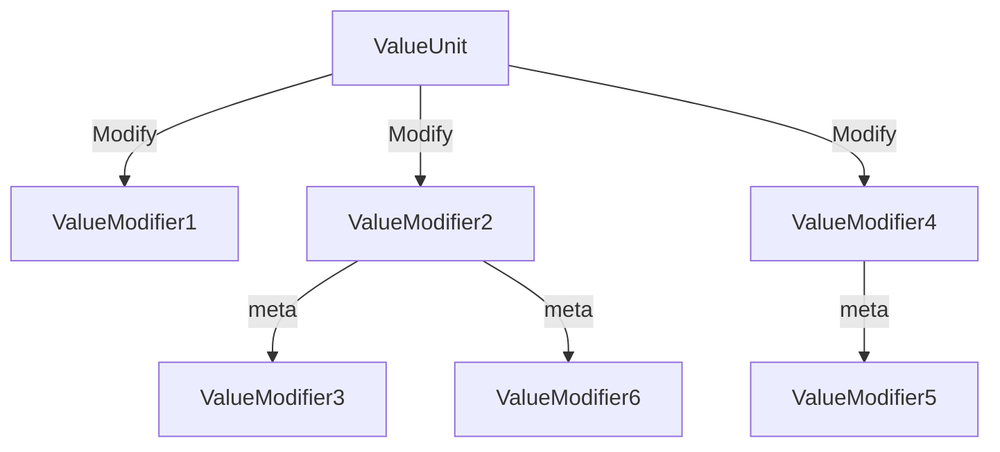

# ValueSystem设计
## 结构设计
1. 提供通用C#的ValueSystem设计。
2. 基于C#的设计扩展到Unity的ScriptableObject封装。

## 数据结构
设计的ValueSystem数据结构为树状。
- 其中root为ValueUnit，为最终数值表达。
- ValueModifier可挂载多个Modifier，用以修饰ValueUnit的值。
  - 此操作为修饰（modify）
- ValueModifier可继续挂载多个Modifier，用以修饰上一级ValueModifier的值。
  - 此操作为元操作（meta）

