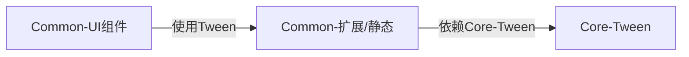

# 规划书

## 2025-11-13
### UI-Tween功能规划
1. 适用于UI的自制Tween功能；该模块提供简单的插值动画功能，支持常用的缓动函数和动画类型，可植入Common模块的通用UI组件中。
2. 该Tween模块预计将在Core模块中完成，并在Common模块中实现对RectTransform的支持（扩展方法或者静态调用）。

- 构建时，可能的两种方案：
  1. `rectTransform.MoveTo(targetPosition, duration)`
  2. `TweenAnime.Move(rectTransform, targetPosition, duration)`

- TweenCore提供各种插值和缓动函数，内置，并用枚举的方式提供；甚至可提供Custom函数的支持。

