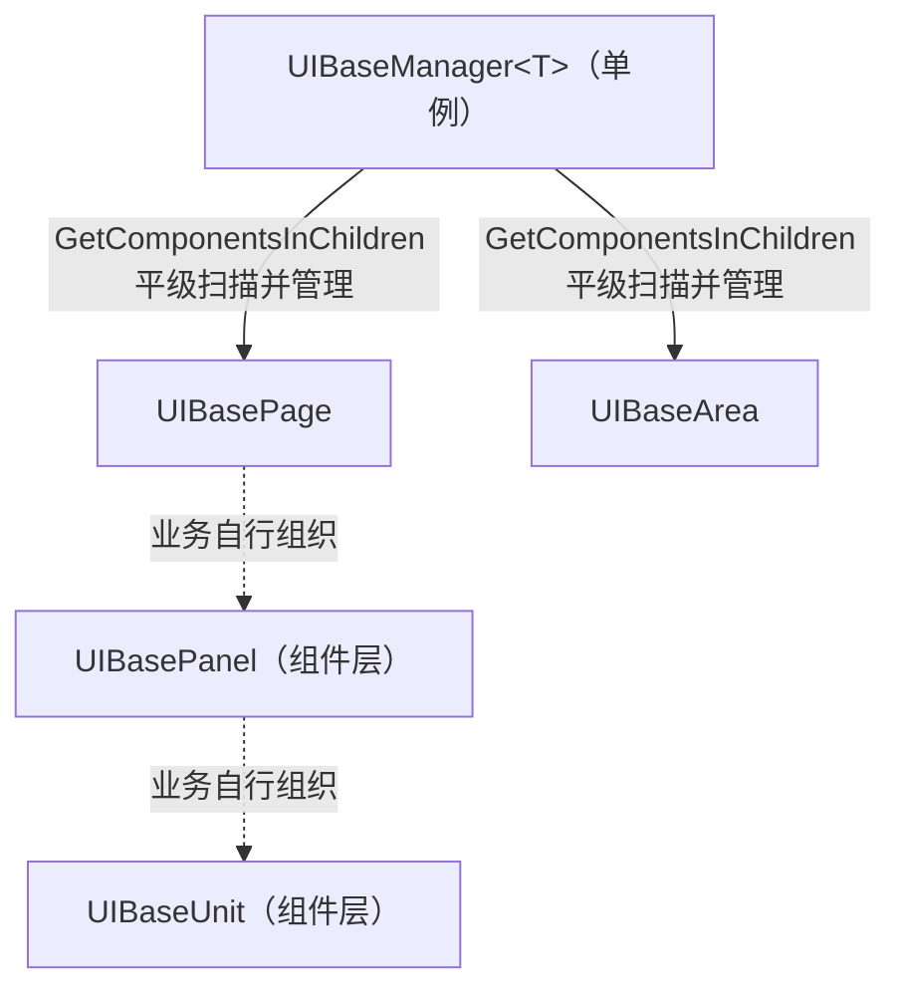

# UI框架

## 层级与职责

- **`UIBaseManager<T>`**：单例，持有并驱动 Page / Area 的 `Show / Hide / Toggle / IsXxxShow / GetXxx`；两者都在其子树内被**平级扫描**收集（不校验父子关系），支持运行时 `RegisterPage / UnregisterPage / RegisterArea / UnregisterArea` 动态登记；列表首次访问时惰性收集，已销毁组件会被存活判定过滤。
- **`UIBaseComponent`**（Page / Area / Panel / Unit 共同基类）：显隐通过 `Content`（默认取名为 `Content` 的直接子物体）`SetActive` 实现；`HideContentOnStart` 控制开局是否隐藏——仅当从未发生过 `Show/Hide/Toggle` 交互时才在 `Start` 应用，避免覆盖手动调用。
- **`UIBasePanel` / `UIBaseUnit`**：组件层基类，**不在 Manager 管理范围**，由业务代码或 UI Kit 组件（如 `UISideToast`）直接驱动。

## 回调与约定

- **回调**：`Show()`/`Hide()` → `OnShow()`/`OnHide()`；带参重载传**非空**参数时 → `OnShow(object[] objs)`/`OnHide(object[] objs)`，参数为空（含 Manager 无参重载传入的空数组）时回落到无参回调。
- **`Content`**：显隐载体；未赋值时仅在 `_autoValidate` 打开时由 `OnValidate` 查找或创建，**不会覆写**手工连好的引用。
- **`Name` / `ID`**：`ID` 用于 Manager 的 `XxxPage<T>(string id)` / `GetPage<T>(string id)` 重载匹配，默认由节点名小写、空格转下划线生成；`OnValidate` 只在为空时补齐。
