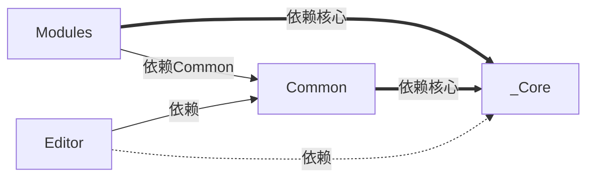

# AxuFrameKit

AxuFrameKit 是一个 Unity 应用程序框架，旨在提供清晰的架构和可复用的组件。基于 Unity 6 (6000.0.23f1) 与 URP 开发。

框架本体以 **Unity Package Manager 嵌入式包**形式提供：`Packages/com.cielevel.axu-frame-kit`（含 3 个程序集定义：`AxuFrameKit.Core` ← `AxuFrameKit.Runtime` ← `AxuFrameKit.Editor`），可直接拷贝 Packages 目录集成到其他 Unity 6 项目。

## 架构概览

本项目采用分层架构设计，确保模块间的低耦合与高内聚：

1.  **_Core (核心层)**
    *   **定位**：框架的核心基础模块。
    *   **特点**：纯 C# 实现，**无任何 Unity 引擎依赖**。包含通用的工具类、数据结构、设计模式实现以及高级架构组件。
    *   **依赖**：无。
    *   **位置**：`Packages/com.cielevel.axu-frame-kit/Runtime/_Core`（程序集 `AxuFrameKit.Core`）。

2.  **Common (通用层)**
    *   **定位**：通用功能模块。
    *   **特点**：提供基于 Unity 环境的通用功能、UI 框架与工具类；编辑器工具层亦在本包内（`Editor/`，程序集 `AxuFrameKit.Editor`）。
    *   **依赖**：Core。
    *   **位置**：`Packages/com.cielevel.axu-frame-kit/Runtime/Common`（程序集 `AxuFrameKit.Runtime`）。

3.  **Modules (模块层)**
    *   **定位**：具体功能模块，即插即用。
    *   **特点**：包含独立的功能特性。**尚未包化**，位于 `Assets/AxuFrameKit/Modules/`，编译进 Assembly-CSharp。
    *   **依赖**：Core, Common。

## 目录结构与功能详解

### 1. `Packages/com.cielevel.axu-frame-kit/Runtime/_Core`
核心代码库，基于 Generic C#，不依赖 Unity API。命名空间：`AxuFrameKit._Core.*`

*   **Advanced** (高级架构组件)
    *   `BetterFSM`: 改进版有限状态机（委托/谓词驱动）；另含泛型版 `FSM`。
    *   `EventSystem`: 类型安全的事件中心 (`EventCenter`)，用于模块间解耦通信。
    *   `ObjectPool`: 通用 C# 对象池 (`SimpleObjPool`, `TypeObjPools`)。

*   **DesignPattern** (设计模式)
    *   `ChainOfResponsibility`: 责任链模式。
    *   `Command`: 命令模式。
    *   `Memento`: 备忘录模式。
    *   `Singleton`: 单例模式基类。

*   **Structure** (数据结构)
    *   `BiDictionary`: 双向字典。
    *   `CircularBuffer`: 环形缓冲区。
    *   `IndexedList` / `IndexedMultiList`: 索引列表。
    *   `PriorityQueue`: 优先级队列。
    *   `ReactiveProperty`: 响应式属性。

*   **Utility** (实用工具)
    *   `Common`: 通用工具 (Logger, Number)。
    *   `Computed`: 响应式派生值 (`Computed<T>`，惰性求值 + 依赖追踪)。
    *   `Encrypt`: 完整加密工具集 (AES / RSA / MD5 / SHA / PBKDF2 / HMAC / Base64 / Hex)。
    *   `Math`: 数学与缓动基座 (`AxuTweener` + Linear~Bounce 全套 Ease，引擎无关)。
    *   `RandomX`: 随机数工具增强 (别名法加权抽样 `AliasSampler`、`RandomId` 等)。
    *   `TaskQ`: 无 MonoBehaviour 依赖的异步任务队列。

*   **Extension** (扩展方法)
    *   涵盖 `String`, `Int`, `Float`, `DateTime`, `Collection`, `Enum`, `Task`, `Type`, `Reflection` 等常用类型的扩展。

---

### 2. `Packages/com.cielevel.axu-frame-kit/Runtime/Common`
基于 Unity 引擎的通用组件与工具。命名空间：`AxuFrameKit.Common.*`

*   **UI** (UI 框架)
    *   `Framework`: UI 页面框架 (`UIBaseManager` → `UIBaseArea` → `UIBasePanel` → `UIBasePage`)。
    *   `Kit/DataBind`: UI 数据绑定组件 (`UIBind*` 系列，约 19 个：Text/TMP/Image/Slider/Dropdown/InputField 等)。
    *   `Kit/ListView`: 虚拟化列表 (`UIListView`，数据绑定 + 对象池 + 可插拔布局引擎)。
    *   `Kit/Scroll`: 循环滚动视图 (`UILoopVerticalScrollRect`)。
    *   `Kit/Toast`: 消息提示组件（边缘推入式 Toast）。
    *   `Kit/ToggleBtnGroup`: 互斥切换按钮组。
    *   `Kit/Typewriter`: TMP 打字机效果。
    *   `Kit/Video`: 视频播放套件。

*   **Utility** (通用工具)
    *   `TaskQ`: 任务队列系统 (`CoroutineQ` 协程队列)。
    *   `Timer`: 倒计时与定时器管理 (`CountdownManager`, `StopwatchManager`)。
    *   `Singleton`: Unity 单例族 (`SingletonLazy`, `SingletonMono`, `SingletonMonoCr`, `SingletonMonoCrDs`)。
    *   `Multiton`: 多例模式实现 (Mono 侧，含 `MultitonManager`)。
    *   `Net`: 网络工具三层 (静态 `HttpUtil`/`Downloader`、可配置 `HttpClient`、生产级 TCP `SocketClient` 长度前缀分包协议)。
    *   `Save`: 存档系统 (`SaveUtil` + 策略化存储后端：本地文件 / JSON / 二进制 / PlayerPrefs)。
    *   `ObjectPool`: GameObject 对象池 (ScriptableObject 配置，Int/Str 键特化)。
    *   `Event`: 事件中心 (`EventCentral` 字符串事件 + `EventChannel<T>` ScriptableObject 事件通道)。
    *   `Auto`: 自动化组件 (AutoSequence 序列播放器、AutoSnapshot 快照录制/回放、AutoCamera、AutoDestroy 等)。
    *   `Math`: Unity 补间系统 (`AxuTween` 运行器 + Move/Scale/Anchor/Fade 等 Tweener，基于 Core 层 Ease)。
    *   `2D`: 2D 相关工具 (EdgeColliderCircleShape)。
    *   `UseMono`: 非 Mono 类代理挂接 Update 等生命周期。

*   **CustomAttribute** (自定义属性)
    *   `CustomMonoBehaviour` / `CustomScriptableObject` 基类与 Inspector 增强属性 (`InsButton`, `InspectorIntro`, `InspectorTitle`)，绘制器在包内 `Editor/`。

*   **Extension** (Unity 扩展)
    *   `Transform`, `Vector`, `Color`, `GameObject`, `RectTransform`, `AsyncOperation` 等 Unity 类型的扩展方法。

*   **Editor 工具** (`Packages/com.cielevel.axu-frame-kit/Editor/`)
    *   `KitBoxRevV2`: 多页签工具箱窗口 "AxuKitBox"（纯 UI Toolkit，页面插件化）。
    *   `Hierarchy`: Hierarchy 窗口增强（规则着色 / 规则图标）。
    *   `Window`: AssetFavorites / SceneJumper / AvatarDownloader / SpriteToAnimation。
    *   `Utility`: TerrainToMesh 转换器、CSV 容器创建窗口、宏定义批量设置等。

---

### 3. 可选模块（独立 UPM 包，2026-08-29 起全部包化）

模块家族（`Packages/com.cielevel.axu-module-*`）：

*   **AITools**（`com.cielevel.axu-module-aitools`）
    *   AI 辅助工具：对话窗口 (Chat)、脚本填充 (Filler)、脚本生成 (Generator)，AIConfig 可脚本化配置。
*   **GizmosUtil**（`com.cielevel.axu-module-gizmos-util`）
    *   Gizmos 辅助绘制库（线/贝塞尔/路径/射线抽屉 + ReorderableList 检视器）。
*   **LiveStream**（`com.cielevel.axu-module-livestream`，依赖框架包）
    *   直播互动模拟：评论/礼物/点赞触发器 SO 体系、模拟器与录制窗口、UI 面板、秋恋猫 HTTP 对接。
*   **Noise**（`com.cielevel.axu-module-noise`，含 FastNoiseLite MIT 第三方声明）
    *   噪声生成 (FastNoiseLite / SimpleNoise + 编辑器预览窗口)。

独立工具包（零依赖，`Packages/com.cielevel.axu-indie-*`）：

*   **SceneJumper**：场景收藏/分组/一键跳转窗口。
*   **SelectionToCsv**：选中资产导出 CSV。
*   **SpriteToAnimation**：精灵序列帧转 AnimationClip/Animator。
*   **StatPipeline**：类 roguelike 数值管线（Stat/Modifier/Calculator/Debugger + 编辑器生成器与分析窗口）。

各包示例位于其 `Samples~/` 目录，经 Package Manager → Samples 导入。

## 依赖关系

