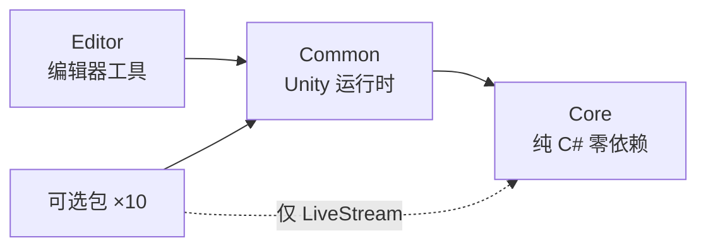

<div align="center">

<picture>
  <source media="(prefers-color-scheme: dark)" srcset="AxuLogo-liquid-dark.svg">
  
</picture>

# AxuFrameKit

**Unity 6 应用程序框架 · 清晰分层架构 · 可复用组件 · 全量 UPM 包化**

[](https://unity.com/releases/editor/whats-new/6000.0.23)
[](https://docs.unity3d.com/Packages/com.unity.render-pipelines.universal@17.0)
[](#包一览)
[](Packages/com.cielevel.axu-test-framework/README.md)

</div>

---

## ✨ 特性

- 🧩 **三层架构**：`_Core`（纯 C#，零 Unity 依赖）→ `Common`（Unity 运行时组件）→ `Editor`（编辑器工具），依赖方向永不逆转
- 📦 **全量 UPM 包化**：框架本体 + 10 个可选包均为独立嵌入式包，按需取用、拷走即用
- 🖥 **成套编辑器工具**：AxuKitBox 多页签工具箱、Hierarchy 规则着色/图标、TerrainToMesh 转换器、CSV 工作流……
- 🌐 **生产级网络**：静态 HTTP 工具 → 可配置 HttpClient → 带长度前缀分包协议的 TCP SocketClient 三层递进
- 🗄 **开箱即用**：UI 页面框架、19 个数据绑定组件、虚拟化列表、存档系统、补间动画、加密套件
- 🤖 **AI Agent 友好**：内置 `com.unity.pipeline`，本地 API 可直接驱动运行中的 Editor 完成编译 / 测试 / 资产操作；配套 `com.cielevel.axu-unity-cli-kit` 把 CLI / Pipeline 用法沉淀成一条命令即可装上的 Agent Skill

## 🏗 架构



> 10 个可选包中，仅 **LiveStream** 依赖框架包，其余全部零依赖、互相独立。

## 📦 包一览

| 包 | 说明 | 文档 |
|---|---|---|
| [`com.cielevel.axu-frame-kit`](Packages/com.cielevel.axu-frame-kit) | **框架本体**：核心库 + 运行时组件 + 编辑器工具（3 个程序集） | [README](Packages/com.cielevel.axu-frame-kit/README.md) · [CHANGELOG](Packages/com.cielevel.axu-frame-kit/CHANGELOG.md) |
| [`com.cielevel.axu-module-aitools`](Packages/com.cielevel.axu-module-aitools) | AI 对话 / 脚本填充 / 脚本生成窗口 | [README](Packages/com.cielevel.axu-module-aitools/README.md) |
| [`com.cielevel.axu-module-gizmos-util`](Packages/com.cielevel.axu-module-gizmos-util) | Gizmos 绘制库（线/贝塞尔/路径/射线） | [README](Packages/com.cielevel.axu-module-gizmos-util/README.md) |
| [`com.cielevel.axu-module-livestream`](Packages/com.cielevel.axu-module-livestream) | 直播互动模拟（依赖框架包） | [README](Packages/com.cielevel.axu-module-livestream/README.md) |
| [`com.cielevel.axu-module-noise`](Packages/com.cielevel.axu-module-noise) | 噪声生成与预览（含 FastNoiseLite） | [README](Packages/com.cielevel.axu-module-noise/README.md) |
| [`com.cielevel.axu-indie-scene-jumper`](Packages/com.cielevel.axu-indie-scene-jumper) | 场景收藏 / 分组 / 快跳窗口 | [README](Packages/com.cielevel.axu-indie-scene-jumper/README.md) |
| [`com.cielevel.axu-indie-selection-to-csv`](Packages/com.cielevel.axu-indie-selection-to-csv) | 选中资产导出 CSV | [README](Packages/com.cielevel.axu-indie-selection-to-csv/README.md) |
| [`com.cielevel.axu-indie-sprite-to-animation`](Packages/com.cielevel.axu-indie-sprite-to-animation) | 精灵序列帧转 AnimationClip / Animator | [README](Packages/com.cielevel.axu-indie-sprite-to-animation/README.md) |
| [`com.cielevel.axu-indie-stat-pipeline`](Packages/com.cielevel.axu-indie-stat-pipeline) | Roguelike 式数值管线 + 编辑器生成器 | [README](Packages/com.cielevel.axu-indie-stat-pipeline/README.md) |
| [`com.cielevel.axu-test-framework`](Packages/com.cielevel.axu-test-framework) | **测试体系 AxuTestFramework**：UTF 工具层 + 场景测试平台（八能力 Agent 运行时、`axu_*` pipeline 命令、AxuTestRunner 看板） | [README](Packages/com.cielevel.axu-test-framework/README.md) |
| [`com.cielevel.axu-unity-cli-kit`](Packages/com.cielevel.axu-unity-cli-kit) | **Axu CLI Agent Kit**：`unity` CLI / Pipeline 用法文档 + 一键装进 8 个 AI 客户端目录的 Agent Skill（无运行时代码） | [README](Packages/com.cielevel.axu-unity-cli-kit/README.md) · [文档索引](Packages/com.cielevel.axu-unity-cli-kit/Documentation~/index.md) |

## 📥 安装

目标工程要求 **Unity 6000.0 LTS+**；`com.cielevel.axu-frame-kit` 位于本仓库 `Packages/` 子目录。

**方式一 · Git URL（推荐）** —— 在目标工程的 `Packages/manifest.json` 中添加：

```json
{
  "dependencies": {
    "com.cielevel.axu-frame-kit": "https://github.com/Cielevel/AxuFrameKitV2.git?path=Packages/com.cielevel.axu-frame-kit"
  }
}
```

可追加 `#<commit>` 锚定具体提交（**本仓库目前未打 tag**）；也可通过 Package Manager → **＋ → Add package from git URL** 粘贴同样的地址。

**方式二 · 嵌入式拷贝** —— 将 `Packages/com.cielevel.axu-frame-kit` 文件夹整体复制到目标工程的 `Packages/` 下，随源码修改即时生效。

**方式三 · 本地路径** —— `"com.cielevel.axu-frame-kit": "file:../LocalPackages/com.cielevel.axu-frame-kit"`（相对路径以目标工程 `Packages/` 目录为基准）。

> 其余平级包同理，把 URL 的 `?path=` 换成对应包目录即可（如 `?path=Packages/com.cielevel.axu-unity-cli-kit`）。**LiveStream 需与框架包同时安装**，其余模块零依赖可单独导入；`axu-test-framework` 供各包统一接入测试，`axu-unity-cli-kit` 也可被任意 Unity 工程单独拉取。

## 🚀 快速上手

```csharp
using AxuFrameKit._Core.Advanced.EventSystem;
using AxuFrameKit.Common.Utility.Singleton;

// 1. 延迟初始化单例（支持编辑器自动清理）
public class GameConfig : SingletonLazy<GameConfig>
{
    public int MaxLevel = 99;
}

// 2. 类型安全事件
public struct PlayerDiedEvent { public int Level; }

EventCenter.Subscribe<PlayerDiedEvent>(e => UnityEngine.Debug.Log($"亡于第 {e.Level} 关"));
EventCenter.Publish(new PlayerDiedEvent { Level = GameConfig.Instance.MaxLevel });
```

更多用法见下方文档导航；完整可运行示例位于 [`Assets/TestAndSample/`](Assets/TestAndSample)。

## 📚 文档导航

文档随代码放置在各包内，以下是高频入口（框架包根 [README](Packages/com.cielevel.axu-frame-kit/README.md) 有全量索引）：

| 主题 | 文档 |
|---|---|
| 框架全量文档索引 | [框架包 README](Packages/com.cielevel.axu-frame-kit/README.md) |
| BetterFSM 状态机 | [ReadMe](Packages/com.cielevel.axu-frame-kit/Runtime/_Core/Advanced/BetterFSM/ReadMe.md) |
| 设计模式（命令/备忘录/责任链） | [README](Packages/com.cielevel.axu-frame-kit/Runtime/_Core/DesignPattern/README.md) |
| 加密套件（AES/RSA/PBKDF2…） | [总览](Packages/com.cielevel.axu-frame-kit/Runtime/_Core/Utility/Encrypt/EncryptUtility.md) · [API](Packages/com.cielevel.axu-frame-kit/Runtime/_Core/Utility/Encrypt/APIReference.md) |
| 数学与插值（Tween 基座） | [Doc_MathUtility](Packages/com.cielevel.axu-frame-kit/Runtime/Common/Utility/Math/Doc_MathUtility.md) |
| UI 页面框架 | [UI框架.md](Packages/com.cielevel.axu-frame-kit/Runtime/Common/UI/Framework/UI框架.md) |
| 数据绑定 DataBind | [HOWTOUSE](Packages/com.cielevel.axu-frame-kit/Runtime/Common/UI/Kit/DataBind/DOC/HOWTOUSE.md) |
| UIListView 虚拟化列表 | [DOC 全套](Packages/com.cielevel.axu-frame-kit/Runtime/Common/UI/Kit/ListView/DOC/README.md) |
| Socket 网络（生产级） | [README](Packages/com.cielevel.axu-frame-kit/Runtime/Common/Utility/Net/Socket/README.md) · [技术设计](Assets/DevDoc/AxuFrameKit/Common/Utility/Net/Socket/TechnicalDesign.md) |
| 存档系统 | [ReadMe](Packages/com.cielevel.axu-frame-kit/Runtime/Common/Utility/Save/ReadMe.md) · [Usage](Packages/com.cielevel.axu-frame-kit/Runtime/Common/Utility/Save/Usage.md) |
| CSV 表格 | [Doc_TableCsvUtility](Packages/com.cielevel.axu-frame-kit/Runtime/Common/Utility/Table/CSV/Doc_TableCsvUtility.md) |
| 快照录制/回放 | [README](Packages/com.cielevel.axu-frame-kit/Runtime/Common/Utility/Auto/AutoSnapshot/README.md) |
| 测试体系（UTF + 场景测试平台） | [测试框架 README](Packages/com.cielevel.axu-test-framework/README.md) |
| 场景测试 schema | [ScenarioSchema.md](Packages/com.cielevel.axu-test-framework/DOC/ScenarioSchema.md) |
| unity CLI / Pipeline 用法与 Agent Skill | [CLI Kit README](Packages/com.cielevel.axu-unity-cli-kit/README.md) · [文档索引](Packages/com.cielevel.axu-unity-cli-kit/Documentation~/index.md) |

## 🗂 仓库结构

```
AxuFrameKitV2/
├── Packages/
│   ├── com.cielevel.axu-frame-kit        # 框架本体（Core / Common / Editor）
│   ├── com.cielevel.axu-module-aitools   # ┐
│   ├── com.cielevel.axu-module-gizmos-util│ │ 可选模块 ×4
│   ├── com.cielevel.axu-module-livestream│ │
│   ├── com.cielevel.axu-module-noise     # ┘
│   ├── com.cielevel.axu-indie-*          # 独立工具 ×4（零依赖）
│   ├── com.cielevel.axu-test-framework   # 测试体系（UTF 工具层 + 场景测试平台）
│   ├── com.cielevel.axu-unity-cli-kit    # CLI / Pipeline 文档 + Agent Skill 安装器
│   └── com.unity.pipeline                # Unity 官方实验包（驱动运行中的 Editor）
├── Assets/
│   ├── Tests/Editor/                     # 工程级冒烟入口（EditMode；框架包测试在包内 Tests/）
│   ├── TestAndSample/                    # 可运行示例（框架全层覆盖）
│   └── AxuExperimental/                  # 实验性模块
└── .zcode/                               # AI 知识库（模块清单 / Pipeline API / 子代理体系）
```

## 🧪 开发

- **测试分两套**：UTF（EditMode / PlayMode，框架包 `Tests/`、工程级 `Assets/Tests/`、各模块包 `Tests/`）与**场景测试平台**（suite JSON 驱动的 Editor PlayMode / Player 真机长跑）
- **运行方式**：Pipeline 自定义命令 `axu_test_run` / `axu_test_status` / `axu_test_report`（UTF），`axu_scenario_*` / `axu_player_*` / `axu_trend_*`（场景套件）；报告落 `Library/AxuTestReports/`，人用看板菜单 `AxuFrameKit/AxuTestRunner`
- **Agent 接入**：`unity` CLI 与 Pipeline 用法见 [CLI Kit 文档索引](Packages/com.cielevel.axu-unity-cli-kit/Documentation~/index.md)；命令参数表与接入约定见 [测试框架 README](Packages/com.cielevel.axu-test-framework/README.md)
- 各包变更记录见各自 `CHANGELOG.md`

---

<div align="center">

**Cielevel** · 以 Unity 6 构建

</div>
