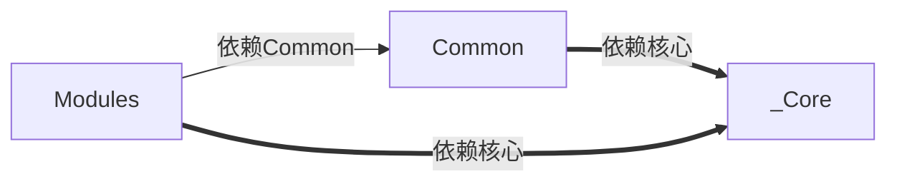

# AxuFrameKit

AxuFrameKit 是一个 Unity 应用程序框架，旨在提供清晰的架构和可复用的组件。

## 架构概览

本项目采用分层架构设计，确保模块间的低耦合与高内聚：

1.  **Core (_Core)**
    *   **定位**：框架的核心基础模块。
    *   **特点**：纯 C# 实现，**无任何 Unity 引擎依赖**。包含通用的工具类、数据结构、设计模式实现以及高级架构组件（如 FSM、事件系统等）。
    *   **依赖**：无。

2.  **Common (Common)**
    *   **定位**：通用功能模块。
    *   **特点**：提供基于 Unity 环境的通用功能和工具类。
    *   **依赖**：Core。

3.  **Modules (Modules)**
    *   **定位**：具体功能模块。
    *   **特点**：包含独立的功能特性（如 Gizmos、LiveStream 等）。
    *   **依赖**：Core, Common。

## 目录结构

*   `Assets/AxuFrameKit/_Core`: 核心代码库 (Generic C#)
    *   `Advanced`: 高级架构组件
    *   `DesignPattern`: 设计模式
    *   `Structure`: 数据结构
    *   `Utility`: 实用工具
    *   `Extension`: 扩展方法
*   `Assets/AxuFrameKit/Common`: Unity 通用组件
*   `Assets/AxuFrameKit/Modules`: 功能模块

## 依赖关系

