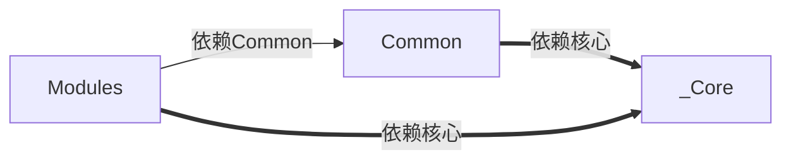

# AxuFrameKit

AxuFrameKit 是一个 Unity 应用程序框架，旨在提供清晰的架构和可复用的组件。

## 架构概览

本项目采用分层架构设计，确保模块间的低耦合与高内聚：

1.  **Core (_Core)**
    *   **定位**：框架的核心基础模块。
    *   **特点**：纯 C# 实现，**无任何 Unity 引擎依赖**。包含通用的工具类、数据结构、设计模式实现以及高级架构组件。
    *   **依赖**：无。

2.  **Common (Common)**
    *   **定位**：通用功能模块。
    *   **特点**：提供基于 Unity 环境的通用功能和工具类。
    *   **依赖**：Core。

3.  **Modules (Modules)**
    *   **定位**：具体功能模块。
    *   **特点**：包含独立的功能特性。
    *   **依赖**：Core, Common。

## 目录结构与功能详解

### 1. `Assets/AxuFrameKit/_Core`
核心代码库，基于 Generic C#，不依赖 Unity API。

*   **Advanced** (高级架构组件)
    *   `EventSystem`: 事件系统，用于模块间解耦通信。
    *   `FSM`: 有限状态机 (Finite State Machine) 实现。
    *   `ObjectPool`: 通用对象池系统。
    *   `ValueSystem`: 数值系统，用于管理复杂的数值逻辑。

*   **DesignPattern** (设计模式)
    *   `ChainOfResponsibility`: 责任链模式。
    *   `Command`: 命令模式。
    *   `Memento`: 备忘录模式。
    *   `Singleton`: 单例模式基类。

*   **Structure** (数据结构)
    *   `BiDictionary`: 双向字典。
    *   `CircularBuffer`: 环形缓冲区。
    *   `IndexedList`: 索引列表。
    *   `PriorityQueue`: 优先级队列。

*   **Utility** (实用工具)
    *   `Common`: 通用工具方法。
    *   `Math`: 数学计算工具。
    *   `Misc`: 杂项工具。
    *   `RandomX`: 随机数工具增强。

*   **Extension** (扩展方法)
    *   涵盖 `Collection`, `Enum`, `Reflection`, `String`, `Type` 等常用类型的扩展。

---

### 2. `Assets/AxuFrameKit/Common`
基于 Unity 引擎的通用组件与工具。

*   **Utility** (通用工具)
    *   `TaskQ`: 任务队列系统，支持链式异步操作 (CoroutineQ, TaskQ)。
    *   `Timer`: 倒计时与定时器管理 (CdManager, CdTimer)。
    *   `Singleton`: Unity 单例实现 (MonoSingleton)。
    *   `Multiton`: 多例模式实现。
    *   `Net`: 网络工具 (Downloader, HttpX)。
    *   `ObjectPool`: GameObject 对象池。
    *   `Event`: 事件中心 (EventCentral)。
    *   `Auto`: 自动化组件 (AutoCamera, AutoDestroy)。
    *   `2D`: 2D 相关工具 (EdgeColliderShaped)。
    *   `UI`: UI 框架基础组件 (UIBaseManager, UIBasePanel 等)。

*   **UI/Kit** (UI 套件)
    *   `DataBind`: UI 数据绑定组件。
    *   `Scroll`: 循环滚动视图 (LoopVerticalScrollRect)。
    *   `Toast`: 消息提示组件。
    *   `Video`: 视频播放套件。

*   **CustomAttribute** (自定义属性)
    *   包含 Inspector 增强属性与自定义编辑器扩展。

*   **Extension** (Unity 扩展)
    *   `Transform`, `Vector`, `AsyncOperation` 等 Unity 类型的扩展方法。

---

### 3. `Assets/AxuFrameKit/Modules`
独立的功能模块，即插即用。

*   **Gizmos**
    *   提供编辑器下的 Gizmos 辅助工具窗口 (`GizmosUtilEditor`)。

*   **LiveStream**
    *   直播/交互相关的功能模块。
    *   包含配对确认逻辑 (`PairConfirm`) 和部分 UI 交互脚本。

## 依赖关系

